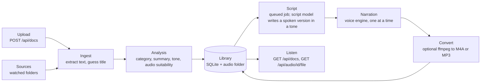

# Architecture

This document explains how Phemius turns a document into audio, which package
does what, and the decisions behind the design. It is for contributors and for
anyone deciding whether Phemius fits their setup.

It describes the code on `main`. Planned parts are marked as planned.

## Pipeline

1. **Ingest.** A file arrives through an upload or a source (see
   [Sources](#sources)).
   `services/ingest.py` extracts plain text from Markdown, text, reStructuredText,
   HTML, DOCX or PDF, and guesses a title from the first heading or line.
2. **Analysis.** `services/agent.py` asks the configured script model
   (`PHEMIUS_SCRIPT_PROVIDER`) for a category, a one-sentence summary, a
   suggested tone with a one-sentence rationale, and an audio suitability
   (`recommended`, `partial` or `not_recommended`) with a one-sentence reason.
   If the model fails, it falls back to the offline rules and keeps the error for
   `GET /api/config`. The rules (`models/suitability.py`) rate a document by the
   share of its characters in tables, code and key/value constants, and also
   stand in for a model reply with no valid rating; `suitability_source` says
   which judged it. Automatic imports skip the audio of a `not_recommended`
   document while `PHEMIUS_SKIP_NOT_RECOMMENDED` is on.
3. **Library.** `store/documents.py` saves the document. A document is
   identified by its source (path or upload filename) and has versions: new text
   from the same source, compared by a SHA-256 hash, adds a version, and the
   same text adds nothing. Each audio belongs to one version, so earlier audio is
   kept.
4. **Script.** Each audio (one per tone and voice) is a job in the queue (see
   [Job queue](#job-queue)). A script worker asks the script model for a spoken
   script of the audio's version. `services/agent.py` first prepares the text
   with `models/spoken_text.py` (code blocks marked for description, tables
   flattened, URLs and images removed; see
   [script-evaluation.md](script-evaluation.md)). A model failure, a cut-off
   reply or a document over 40,000 characters raises `ModelError`, and the job
   fails with its message and hint. A configured model never falls back to an
   offline script. The adapter returns the script with the tokens the provider
   reported, and `services/usage.py` stores them on the job with a cost: the
   price the provider reported (OpenRouter), else an estimate from
   `PHEMIUS_SCRIPT_INPUT_PRICE` and `PHEMIUS_SCRIPT_OUTPUT_PRICE`, zero for a
   local model (Ollama, offline), and null otherwise.
5. **Narration.** The configured voice engine (`PHEMIUS_TTS`) writes a WAV file,
   and its length, read from the WAV header, is stored on the audio.
   A single narration worker keeps synthesis to one audio at a time, because
   local voice models are heavy.
6. **Convert.** If `PHEMIUS_FORMAT` asks for M4A or MP3, the job moves to the
   `converting` stage, and a converting worker runs `ffmpeg` (no shell, a
   timeout, stderr kept out of the logs) through `services/ffmpeg.py`. The WAV
   is deleted only after the converted file is saved. Without ffmpeg, or when
   it fails, the job still finishes `done` with the WAV, and the audio's
   `conversion_note` says why. Each audio records its `format` and
   `size_bytes`. ffmpeg is optional: `GET /api/config` reports it under
   `ffmpeg` (presence, version, status `ok` or `optional`, hint).

### Job queue

Background work is persisted in the `jobs` table (`store/jobs.py`) and run by
`services/runner.py`: `PHEMIUS_SCRIPT_WORKERS` threads (default 2) write scripts
in parallel, one thread narrates and one converts. Workers poll the table and are woken when
work is queued, retried or resumed. There is no broker (ADR-001).

Every screen and endpoint uses one vocabulary:

| Field | Values |
| --- | --- |
| `state` | `queued` (waiting for a worker), `running`, `done`, `failed`, `cancelled` |
| `stage` | `writing_script`, then `narrating`, then `converting` when the output format is M4A or MP3: the step a job is running or waiting for |
| `progress` | Fraction of the current stage, 0 to 1. Engines do not report partial progress yet, so it moves from 0 to 1 at the end of a stage |
| `error`, `hint` | Message and hint of the `ModelError` or `VoiceError` that failed the job, stored separately |
| `attempts` | 1, plus one per retry |

An audio has exactly one job, and its `status`, `stage`, `error` and `hint` in
`GET /api/audio/{id}` are read from that job; the audio row stores only the
script and the file (path, format, size and any conversion note), so the two
cannot disagree. A document's `status` in `GET /api/docs` is the state of its
latest version's newest audio job, or `no_audio` when that version has none.

- **Stages.** A worker claims the oldest job queued for its stage and marks it
  `running`. When the script is written the job goes back to `queued` at
  `narrating`, so a job waits for the narration worker without holding a
  script worker.
- **Pause** is a queue flag, not a job state: while paused, workers claim
  nothing, and running steps finish. It is stored, so it survives a restart.
- **Cancel** applies to `queued` and `running` jobs. A running step cannot be
  interrupted, so it finishes and its result is discarded.
- **Retry** applies to `failed` and `cancelled` jobs. A job whose script was
  written resumes at `narrating`, so a voice failure does not pay for a second
  script. A job interrupted while `converting` also resumes at `narrating`. Re-running a stage overwrites that job's script or file.
- **Restart.** On startup every `running` job becomes `failed` with "Interrupted
  by a restart" and can be retried; `queued` jobs resume.
- **Fencing.** Workers write a stage's result only if the job is still
  `running` on the same attempt, so a step that finishes after a cancel or a
  retry cannot overwrite the newer state.

### Configuration

`config.load_config()` resolves each field of `config.Settings` from its
environment variable, then the saved value in the `settings` table, then the
default, and validates the result with Pydantic. It runs on each use, so saved
settings apply without a restart. `PHEMIUS_DATA_DIR` and `PHEMIUS_LOG_LEVEL`
come only from the environment, because the database that holds saved settings
lives in the data folder. A setting fixed by an environment variable is locked
against changes through `PATCH /api/settings`.

### Sources

A source is a place Phemius imports documents from. Each is a row in the
`sources` table (`store/sources.py`): `kind`, `name`, `config` (JSON, the
source's identity, so the same folder cannot be added twice), `status`
(`active` or `paused`), `last_sync` and `error` (why the last sync failed;
cleared by the next good one). Each document records the source it came from
in `docs.source_id` (null for uploads), which per-source exclusions will key
on.

- **Kinds.** A kind implements the `Source` protocol (`sources/base.py`) and is
  registered in `SOURCE_KINDS` (`sources/__init__.py`): one module with a
  `from_config` factory that validates the config, and one registry line. A
  source only finds documents: `sync()` hands every item it holds to a handler
  until its stop event is set,
  and `watch()` hands over new and changed items as they appear (None for a
  kind that cannot be watched). Each item has a stable `key`, stored as
  `docs.source`, so a changed item adds a version. Today the only kind is
  `folder` (`sources/folder.py`, watchdog), whose keys are file paths.
- **Importing** lives in `services/source_imports.py`, the same for every
  kind: it checks the source is still active, applies its import rules,
  imports the item through `services/pipeline.py`, and records an activity
  entry. One bad item is recorded and skipped. A source that cannot be read at
  all records its `error` and a `failed` entry.
- **Import rules** (`services/import_rules.py`) are saved per source in
  `sources.rules` as overrides only; a rule left unset follows the global
  setting, so changing that setting still reaches every source that never
  chose otherwise.

  | Rule | Without an override |
  | --- | --- |
  | `auto_audio`: queue audio for a new document | on |
  | `skip_not_recommended`: no automatic audio for a `not_recommended` document | `PHEMIUS_SKIP_NOT_RECOMMENDED` |
  | `keep_versions`: keep earlier versions and their audio when a document changes | on |
  | `regenerate_on_change`: queue audio for a new version | `PHEMIUS_WATCH_ON_CHANGE` is `regenerate` |
  | `file_types`: extensions to import | every supported type |

  Without `keep_versions`, a new version deletes the earlier ones with their
  audio rows, jobs and files (files after the commit). A version whose job is
  running is kept until a later change, and so is everything while a library
  operation holds the maintenance gate.
- **Activity** (`source_activity`) is the log behind S3 Recent activity:
  `imported`, `updated`, `skipped` (a left-out file type, or a
  `not_recommended` document imported without audio) and `failed` (an item
  that could not be imported, audio that could not be queued, or the whole
  source), each with the item's name, the document id when there is one, and
  a `detail` in plain words. A skip or failure that repeats the item's latest
  entry is not recorded again, so a broken file does not fill the log on every
  sync. Entries never hold document text. Deleting a source deletes its
  activity; its documents stay, with no source.
- **Watchers follow the sources.** Startup adopts the old watched folder, then
  starts a watcher and a sync thread for each active source. Adding or
  resuming a source starts them, a new config restarts them, and pausing or
  deleting stops them. A sync takes a stop signal and ends between items;
  pausing or deleting a source signals its running syncs without waiting, and
  an item already being handed over is dropped because its source is no
  longer active. Shutdown signals every watcher and sync and then waits for
  them, so at most the item being imported finishes and nothing touches the
  library after the app stops. A sync ended early does not update
  `last_sync`.
- **The old watched folder.** `PHEMIUS_WATCH_DIR` becomes a folder source on
  every start (nothing happens once that source exists), so the environment
  keeps winning as it does for settings; its source can be renamed, paused and
  given rules, but moving or deleting it returns `409 setting_locked` while the
  variable is set. A saved `watch_dir` becomes a source once and the setting
  is deleted in the same transaction, so deleting that source sticks. Documents
  already imported from inside the folder are linked to the new source.

### Setup checks

`POST /api/checks` (`services/checks.py`) runs the setup checks for S7 and
the C3 summary: Python version against Kokoro's range, script model
reachability (the adapter's `check()`, with latency), voice engine readiness,
library folder writable with at least 1 GB free, every active source
readable (`watch_folder`; optional when there is none), and ffmpeg. Each
returns `status` `ok`, `optional` or `needs_attention`, with a `detail` and a
`hint`. Each check runs in its own daemon thread. One that has
not answered within 3 seconds is reported as `needs_attention`, and the response
does not wait for it. The last run and a count per status are kept in memory and
returned by `GET /api/checks` (null before the first run). They describe
the running process's environment, which a restart can change, so they are not
stored. There are no connector checks until the GitHub and Confluence
connectors exist.

### Library operations

S7 backs up, restores and deletes all audio through `/api/library`
(`services/backup.py`, `services/restore.py`, `services/library.py`).

- **One at a time, never during a job.** Each operation closes the
  maintenance gate (`services/maintenance.py`). Workers take a turn through
  the gate for every claim and stage, so while it is closed they claim nothing.
  An operation is refused with a 409 `library_busy` and a hint while a job is
  `running` or another library operation holds the gate. Queued jobs wait.
- **Backup** (`POST /api/library/backup`) downloads one zip: `manifest.json`
  (format `phemius-backup`, `format_version` 1, app and schema versions, counts),
  `library.db` and `audio/<file>` for each audio file. The database is copied
  with SQLite's backup API, never by copying the live file. Saved API keys
  (every setting whose `EnvVar` is secret) and the access token hash are
  deleted from the copy, which is then vacuumed so no deleted page keeps them,
  and audio paths become relative (`audio/12.wav`). The zip is written to an
  owner-only temporary file in the library folder and streamed from disk; it is
  deleted once sent, and startup removes any a stopped server left behind.
- **Restore** (`POST /api/library/restore`, with `POST
  /api/library/restore/inspect` to report the contents without changing
  anything) checks the archive before touching the library: only
  `manifest.json`, `library.db` and flat `audio/<name>` members (no `..`, no
  absolute or hidden names, no repeats), at most 100,000 members and 50 GB
  unpacked, enough free disk space, a manifest with the `phemius-backup` format
  and a known `format_version`, an intact database with a schema no newer than
  this version's, and no schema object (table, index, trigger or view) that a
  new library migrated to the same schema version would not have. That last
  check compares type, name and SQL with whitespace collapsed against a
  reference built in memory from `MIGRATIONS`. Without it, a crafted archive
  could bring a trigger that rewrites settings on a later write. Every
  connection to an unpacked database runs with `PRAGMA trusted_schema=OFF`.
  Anything else is a 400 `invalid_backup` with a hint. It
  unpacks into an owner-only `.restore-*` folder in the library folder (files
  `0600`, `audio/` `0700`, so restored files have the library's permissions),
  runs migrations there, fails any `running` job as interrupted, pauses the
  queue, and points audio paths at the live `audio/`. Then it swaps: the live `audio/` is renamed
  aside, the restored one renamed in, and the database replaced with SQLite's
  backup API, which copies it in one write transaction. If that fails, the
  audio folders are renamed back, so the previous library is untouched until
  the swap succeeds. A server stopped mid-swap leaves the previous audio in the
  `.restore-*` folder, so startup does not delete those.
- **What a restore keeps.** These belong to the installation, not the library:
  API keys, the access token hash, `access_mode`, `script_provider`,
  `script_base_url`, `ollama_url`, `voice_engine`, `openai_speech_base_url`,
  `watch_dir`, and the sources. An archive's values for them are ignored, and a
  restore keeps the current ones. So a server in `network` mode keeps accepting
  the same token, a restored endpoint cannot receive this installation's keys,
  and a folder path from another machine is not watched here. The archive's
  source activity goes with its sources, and restored documents are relinked
  to this installation's sources by key prefix (a document under a kept
  folder joins it; others have no source).
- **The queue is paused after a restore.** The restore response reports
  `is_queue_paused` (always true) and `queued_jobs`, so the UI can offer
  Resume, and restored jobs never spend model credits unasked.
- **Running app during a restore.** Store connections are opened per
  transaction, so there is no pool to reset: the first transaction after the
  swap reads the restored library. Workers claim nothing while the gate is
  closed. When it opens they find the restored queue paused. A document imported by an upload or the watched
  folder during a restore lands in whichever library is live at that moment.
- **Delete all audio** (`DELETE /api/library/audio`) removes every audio file
  but keeps documents, versions and scripts. The script lives on the audio row,
  so the rows stay with their file columns cleared, and every `done` or
  `queued` job becomes `cancelled` with "Audio file deleted". Retrying one
  narrates the saved script again without a model call. Rows change in one
  transaction; the files, and any file in `audio/` no row points at, are
  deleted after it commits. A file already missing is not an error.

## Components

| Package | Responsibility |
| --- | --- |
| `src/phemius/app.py` | FastAPI app: startup (logging, library permissions, database, audio folder, access token, folder watcher, voice engine check), request logging, the access token check, routers, and the built UI with a fallback to `index.html` for client-side routes |
| `src/phemius/cli.py` | `phemius serve`: opens the library, binds to the address the access mode allows (`127.0.0.1` for `local` and `proxy`, `0.0.0.0` for `network`) and runs uvicorn without its access log, which would print signed audio URLs |
| `src/phemius/config.py` | `Settings` (the options a user can save, each tied to its environment variable), `Config` and `load_config()` |
| `src/phemius/errors.py` | `PhemiusError` and its subclasses (`NotFoundError`, `InvalidInputError`, `SettingLockedError`, `JobStateError`, `LibraryBusyError`, `InvalidBackupError`, `ServiceUnavailableError`, `ModelError`, `VoiceError`), each with a message, optional hint, field errors and status code |
| `src/phemius/openapi.py` | Exports the OpenAPI schema that `make api-types` turns into the UI's API types |
| `src/phemius/api/` | Thin routers: `health`, `library_config` (`/api/config`), `settings`, `docs` (paginated, filtered list and uploads), `audio`, `queue` (jobs, cancel, retry, pause and resume), `checks` (setup checks), `library` (backup, restore and delete all audio), `stats` (today's totals), `sources` (sources CRUD, pause, resume, sync now and the activity log), `access` (token regeneration and the middleware that requires the token on `/api/*` except `/api/health` in `network` and `proxy` modes, or a signed URL on an audio file), `request_guard` (the Host and Origin checks below), plus `pagination.py` (shared `limit`/`offset` page shape) and `errors.py`, which maps every error to `{detail, code, hint, errors}` |
| `src/phemius/services/` | Business logic: `ingest` (text extraction), `agent` (analysis and scripts through the script model), `script_models` (the active provider and model, or why it cannot be built), `pipeline` (import, queuing audio and the script, narration and conversion stages), `ffmpeg` (optional conversion to M4A or MP3, and the ffmpeg check), `queue` (list, cancel, retry, pause and resume), `runner` (the worker threads and restart recovery), `voices` (voice listing, engine check, voice id resolution), `settings` (settings overview and updates, secrets write-only), `access` (bind address and host guard, token from `PHEMIUS_ACCESS_TOKEN` or generated, regeneration and constant-time check; only a SHA-256 hash is stored; signing and checking short-lived audio file URLs, see ADR-004), `checks` (setup checks in parallel with a timeout, last run kept in memory), `sources` (adding, editing, pausing and deleting sources, adopting the watched folder, watchers and syncs), `source_imports` (one item under its source's rules, and its activity entry), `import_rules` (per-source rules over the global settings), `backup` (backup archives), `restore` (archive checks and the swap), `library` (delete all audio), `maintenance` (the gate that keeps workers and library operations apart), `usage` (script cost from the provider's price or configured prices), `stats` (today's scripts, audio, narration minutes and cost, at the caller's UTC offset), `uploads`, `health` |
| `src/phemius/models/` | Script model adapters behind the `ScriptModel` protocol (`base.py`), registered in `SCRIPT_MODELS`: `offline.py` (rules, no network), `openai_compatible.py` (any OpenAI chat API server, with `openai` and `openrouter` presets) and `ollama.py`. `chat.py` is the shared base for chat-completion providers, `prompts.py` holds the tones, categories and prompts every model uses, `spoken_text.py` prepares document text for any model, and `suitability.py` rates how well a document suits listening when no model does |
| `src/phemius/voices/` | Voice engine adapters behind the `VoiceEngine` protocol (`base.py`), registered in `ENGINES`: `kokoro.py` (local, optional extra), `piper.py` (local, optional GPL extra, see ADR-003), `openai_speech.py`, `elevenlabs.py` and `stub.py` (silent audio), plus shared text chunking |
| `src/phemius/sources/` | Source kinds behind the `Source` protocol (`base.py`), registered in `SOURCE_KINDS`. Today: `folder.py`, a folder synced by walking it and watched with watchdog |
| `src/phemius/store/` | The only package that runs SQL: connections in WAL mode with a busy timeout, migrations tracked with `PRAGMA user_version`, documents, audio, jobs (with script usage and cost), daily totals, saved settings and sources, and `backup.py` for SQL on a library snapshot outside the live database. `permissions.py` keeps the library folder and database owner-only |
| `frontend/` | React, Vite and TypeScript UI with TanStack Router and Query and Tailwind CSS. `make build` writes it to `src/phemius/static` (not committed); in development, Vite serves it on port 5173 and proxies `/api`. API types in `src/lib/api-schema.d.ts` are generated from `frontend/openapi.json`. Node is needed only to develop or build it |

The library is one folder (`PHEMIUS_DATA_DIR`, default `~/.phemius`) holding
`library.db` (documents, audio records, jobs and saved settings, including any saved
API key) and `audio/`. Back it up from Settings (see
[Library operations](#library-operations)), or by copying the folder while
Phemius is stopped.

A saved API key sits in `library.db` in plain text, as it would in a `.env`
file, so the library is private to its owner. `store/permissions.py` creates
the folder `0700` and the database `0600` with those modes from the start
(never a chmod after the fact, which would leave a window where another user
could open them), and SQLite gives the `-wal` and `-shm` files the database's
mode. Startup removes group and other access from an existing folder and
database and logs one `library_permissions_tightened` warning with the paths.
`audio/` is created `0700` too, but the folder's mode already makes it
unreachable. A watched folder belongs to the user and is never changed. On
Windows (no POSIX modes) the tightening is skipped. Deployments should pass keys
as environment variables or a `.env` file given to Docker; those take
precedence and are never written to the library.

Local mode has no token, so `api/request_guard.py` stops other websites from
using the browser to reach it. In local mode every request except
`/api/health` (probed by Docker) must carry a loopback `Host` (`localhost` or
any loopback IP, any port), or it gets `400 untrusted_host`; this defeats DNS
rebinding, where a page points its own domain at `127.0.0.1`. In every mode, a
`POST`, `PUT`, `PATCH` or `DELETE` is refused with `403 cross_site_request` when
`Sec-Fetch-Site` is anything but `same-origin` or `none`, or, from browsers that
do not send it, when the `Origin` host and port differ from `Host`. Requests
without either header (curl, the CLI) pass. `Sec-Fetch-Site` wins over `Origin`
because a reverse proxy may rewrite `Host`. The guard runs before the token
check. The Vite dev proxy sets `changeOrigin: false` so `Host` stays the
browser's `localhost:5173`.

## Decision log

Each decision is recorded as an ADR. Add a new one, with the next number, when a
change reverses or extends a decision. Do not rewrite an accepted ADR; mark it
superseded and link to the new one.

### ADR-001: SQLite in WAL mode and background threads over Postgres and a broker

- **Status:** Accepted
- **Date:** 2026-10-28

**Context.** Phemius is self-hosted by people who want to hear their docs, not
run infrastructure. A new user should go from one install command to hearing
audio in about ten minutes. The workload is a single user with a small library:
few writes (a document import, a status update per audio step) and mostly reads.
Long work (scripts and narration) has to happen in the background.

**Decision.** Store the library in SQLite in WAL mode with a busy timeout, and run
background work in threads, with a SQLite-backed job queue when one is needed. Do
not use Postgres, Redis, Celery or any other broker. All SQL lives in
`src/phemius/store/`.

**Consequences.**

- Installs need no setup: no database server, no broker, no second service.
- The whole library is one database file plus an audio folder, so backing it up
  or moving it is a copy.
- WAL mode lets the UI read while a background thread writes. Write transactions
  stay short, and no network call runs inside one.
- Phemius runs as a single server process. It cannot be scaled out to several
  instances sharing one library.
- Keeping all SQL in `store/` means a future database swap touches one package.

**When to revisit.** Only if Phemius needs multiple server instances, a hosted
multi-user version, or heavy concurrent writes. Revisiting requires a new ADR.

### ADR-002: Pluggable script model and voice adapters

- **Status:** Accepted
- **Date:** 2026-10-28

**Context.** Users bring their own models: a hosted provider with an API key, any
OpenAI-compatible server, or a local LLM such as Ollama. Voices vary the same way
(Kokoro, Piper, OpenAI-compatible speech, ElevenLabs). A fully local setup must
keep working offline. Hard-wiring one provider would lock users in and spread
provider details through the code.

**Decision.** Script models and voice engines live behind small protocols:
`ScriptModel` in `src/phemius/models/` and `VoiceEngine` in
`src/phemius/voices/`. Each provider is one adapter file plus one registry line,
selected by configuration. Adapters map provider failures to `ModelError` or
`VoiceError` with a `message` and a `hint`. No provider-specific code exists
outside these two packages.

**Consequences.**

- Adding a provider is one file and one registry line, and does not touch
  routes, services or the store.
- The stub voice engine and a fake script model let the whole pipeline run in
  tests with no network, keys or model downloads.
- Errors look the same in the UI whichever provider failed, and always carry a
  hint the user can act on.
- Adapters can expose only what every provider supports through the shared
  protocol. Provider-specific features need a protocol change or stay inside the
  adapter.

**Current state.** Both registries exist. `ScriptModel` (`models/base.py`) has
the `offline` and `openai_compatible` adapters in `SCRIPT_MODELS`, plus the
`openai` and `openrouter` presets, selected with `PHEMIUS_SCRIPT_PROVIDER`; `services/agent.py` reaches them only through
`get_script_model()`. `VoiceEngine` (`voices/base.py`) has the `kokoro` and
`stub` engines in `ENGINES`, selected with `PHEMIUS_TTS`. Voice ids are
namespaced by engine (`kokoro:af_heart`), and each engine reports whether it is
ready through `check()`. OpenAI-compatible servers, Ollama, Piper,
OpenAI-compatible speech and ElevenLabs are planned.

**When to revisit.** If a provider needs a fundamentally different interaction
than the protocols allow (for example streaming audio or multi-step tool use),
extend the protocol through a new ADR rather than special-casing the provider.

### ADR-003: Piper is an optional extra, never bundled by default

- **Status:** Accepted
- **Date:** 2026-10-28

**Context.** Piper is a small, fast voice engine that suits low-power machines.
`piper-tts` 1.3 and later is licensed GPL-3.0-or-later, while Phemius is
Apache-2.0. The last MIT release, 1.2.0, depends on `piper-phonemize`, which has
no Python 3.12 wheels, so it cannot be installed alongside Kokoro.

**Decision.** Piper is available only through the optional `piper` extra
(`uv sync --extra piper`). It is never part of the default install, the wheel's
required dependencies or the Docker image (#18). Kokoro stays the default
engine. The Piper adapter imports `piper` lazily, so Phemius runs without it.

**Consequences.**

- The default install and the Docker image ship only Apache-2.0-compatible
  dependencies.
- Users who want Piper install it themselves and accept its license.
- Docker users who want Piper build their own image or install the extra in the
  container.
- Piper voices download on demand with their own dataset licenses; the default
  Piper voice is CC0, and the README lists each voice's license.

**When to revisit.** If a permissively licensed Piper release supports Python
3.12, or if the project decides to ship a separately licensed Piper image.

### ADR-004: Short-lived signed URLs for audio files, not a cookie

- **Status:** Accepted
- **Date:** 2026-10-28

**Context.** In `network` and `proxy` modes every `/api/*` request needs the
access token. The browser's `<audio>` element cannot send an `Authorization`
header, so the file route accepted `?token=` instead (#80). A token in a URL
leaks into browser history, proxy logs and anything the URL is copied into, and
it never expires. A cookie would avoid the URL, but the browser sends it with
every request, including ones another site triggers, which reopens the
cross-site request surface tracked in #84.

**Decision.** `GET /api/audio/{id}/url`, which needs the token like every API
route, returns a URL to the file signed with HMAC-SHA256 over the audio id and
an expiry six hours ahead (`AUDIO_URL_LIFETIME_SECONDS`). The key is derived
from the stored token hash, so regenerating the token revokes every
outstanding URL. The file route accepts a valid, unexpired signature for that
audio only, on reads, in place of the bearer header. The token is no
longer accepted in a query string anywhere. In `local` mode the URL is
unsigned, as nothing asks for a token. The player fetches a fresh URL once when
the audio element fails and resumes at the same position.

**Consequences.**

- The token never appears in a URL, log or browser history; a leaked audio URL
  exposes one file for at most six hours.
- No ambient credential exists, so a cross-site request still cannot reach the
  library.
- Playing audio costs one extra request, and long sessions refetch the URL when
  it expires.
- The browser caches a file per signed URL, so a new URL fetches the file
  again.

**When to revisit.** If Phemius gains another client that streams audio without
headers (for example a podcast feed), or if signed URLs need to outlive a
listening session.
