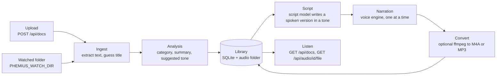

# Architecture

This document explains how Phemius turns a document into audio, which package
does what, and the decisions behind the design. It is for contributors and for
anyone deciding whether Phemius fits their setup.

It describes the code on `main`. Planned parts are marked as planned.

## Pipeline

1. **Ingest.** A file arrives through an upload or the watched folder.
   `services/ingest.py` extracts plain text from Markdown, text, reStructuredText,
   HTML, DOCX or PDF, and guesses a title from the first heading or line.
2. **Analysis.** `services/agent.py` asks the configured script model
   (`PHEMIUS_SCRIPT_PROVIDER`) for a category, a one-sentence summary and a
   suggested tone. If the model fails, it falls back to the offline rules and
   keeps the error for `GET /api/config`.
3. **Library.** `store/documents.py` saves the document. Documents are
   deduplicated by a SHA-256 hash of their text, so the same content is stored
   once.
4. **Script.** For each audio (one per tone and voice), `services/pipeline.py`
   resolves the voice through `services/voices.py` and starts a background
   thread, which asks the script model for a spoken script. A model failure,
   a cut-off reply or a document over 40,000 characters raises `ModelError`, and
   the audio fails with a hint. A configured model never falls back to an offline
   script.
5. **Narration.** The configured voice engine (`PHEMIUS_TTS`) writes a WAV file.
   A lock keeps synthesis to one audio at a time, because local voice models are
   heavy. Script writing for several audios can run in parallel.
6. **Convert.** If `PHEMIUS_FORMAT` asks for M4A, MP4 or MP3 and `ffmpeg` is on
   the `PATH`, the WAV is converted. Otherwise the WAV is kept.

Each audio row records its progress: `pending`, `scripting`, `synthesizing`, then
`done` with a file path, or `error` with the message and hint. Clients read it
from `GET /api/docs` and `GET /api/audio/{id}`.

### Configuration

`config.load_config()` resolves each field of `config.Settings` from its
environment variable, then the saved value in the `settings` table, then the
default, and validates the result with Pydantic. It runs on each use, so saved
settings apply without a restart. `PHEMIUS_DATA_DIR` and `PHEMIUS_LOG_LEVEL`
come only from the environment, because the database that holds saved settings
lives in the data folder. A setting fixed by an environment variable is locked
against changes through `PATCH /api/settings`.

## Components

| Package | Responsibility |
| --- | --- |
| `src/phemius/app.py` | FastAPI app: startup (logging, database, audio folder, folder watcher, voice engine check), request logging, routers, and the built UI with a fallback to `index.html` for client-side routes |
| `src/phemius/config.py` | `Settings` (the options a user can save, each tied to its environment variable), `Config` and `load_config()` |
| `src/phemius/errors.py` | `PhemiusError` and its subclasses (`NotFoundError`, `InvalidInputError`, `SettingLockedError`, `ServiceUnavailableError`, `ModelError`, `VoiceError`), each with a message, optional hint, field errors and status code |
| `src/phemius/openapi.py` | Exports the OpenAPI schema that `make api-types` turns into the UI's API types |
| `src/phemius/api/` | Thin routers: `health`, `library_config` (`/api/config`), `settings`, `docs`, `audio`, plus `errors.py`, which maps every error to `{detail, code, hint, errors}` |
| `src/phemius/services/` | Business logic: `ingest` (text extraction), `agent` (analysis and scripts through the script model), `pipeline` (import and audio generation in threads), `voices` (voice listing, engine check, voice id resolution), `settings` (settings overview and updates, secrets write-only), `uploads`, `health` |
| `src/phemius/models/` | Script model adapters behind the `ScriptModel` protocol (`base.py`), registered in `SCRIPT_MODELS`: `offline.py` (rules, no network) and `openrouter.py`. `chat.py` is the shared base for chat-completion providers, and `prompts.py` holds the tones, categories and prompts every model uses |
| `src/phemius/voices/` | Voice engine adapters behind the `VoiceEngine` protocol (`base.py`), registered in `ENGINES`: `kokoro.py` (local, optional extra) and `stub.py` (silent audio), plus shared text chunking |
| `src/phemius/sources/` | Source connectors. Today: `folder.py`, a watchdog-based folder watcher |
| `src/phemius/store/` | The only package that runs SQL: connections in WAL mode with a busy timeout, migrations tracked with `PRAGMA user_version`, documents, audio and saved settings |
| `frontend/` | React, Vite and TypeScript UI with TanStack Router and Query and Tailwind CSS. `make build` writes it to `src/phemius/static` (not committed); in development, Vite serves it on port 5173 and proxies `/api`. API types in `src/lib/api-schema.d.ts` are generated from `frontend/openapi.json`. Node is needed only to develop or build it |

The library is one folder (`PHEMIUS_DATA_DIR`, default `~/.phemius`) holding
`library.db` (documents, audio records and saved settings, including any saved
API key) and `audio/`. Back it up by copying the folder while Phemius is
stopped.

## Decision log

Each decision is recorded as an ADR. Add a new one, with the next number, when a
change reverses or extends a decision. Do not rewrite an accepted ADR; mark it
superseded and link to the new one.

### ADR-001: SQLite in WAL mode and background threads over Postgres and a broker

- **Status:** Accepted
- **Date:** 2026-10-28

**Context.** Phemius is self-hosted by people who want to hear their docs, not
run infrastructure. A new user should go from one install command to hearing
audio in about ten minutes. The workload is a single user with a small library:
few writes (a document import, a status update per audio step) and mostly reads.
Long work (scripts and narration) has to happen in the background.

**Decision.** Store the library in SQLite in WAL mode with a busy timeout, and run
background work in threads, with a SQLite-backed job queue when one is needed. Do
not use Postgres, Redis, Celery or any other broker. All SQL lives in
`src/phemius/store/`.

**Consequences.**

- Installs need no setup: no database server, no broker, no second service.
- The whole library is one database file plus an audio folder, so backing it up
  or moving it is a copy.
- WAL mode lets the UI read while a background thread writes. Write transactions
  stay short, and no network call runs inside one.
- Phemius runs as a single server process. It cannot be scaled out to several
  instances sharing one library.
- Keeping all SQL in `store/` means a future database swap touches one package.

**When to revisit.** Only if Phemius needs multiple server instances, a hosted
multi-user version, or heavy concurrent writes. Revisiting requires a new ADR.

### ADR-002: Pluggable script model and voice adapters

- **Status:** Accepted
- **Date:** 2026-10-28

**Context.** Users bring their own models: a hosted provider with an API key, any
OpenAI-compatible server, or a local LLM such as Ollama. Voices vary the same way
(Kokoro, Piper, OpenAI-compatible speech, ElevenLabs). A fully local setup must
keep working offline. Hard-wiring one provider would lock users in and spread
provider details through the code.

**Decision.** Script models and voice engines live behind small protocols:
`ScriptModel` in `src/phemius/models/` and `VoiceEngine` in
`src/phemius/voices/`. Each provider is one adapter file plus one registry line,
selected by configuration. Adapters map provider failures to `ModelError` or
`VoiceError` with a `message` and a `hint`. No provider-specific code exists
outside these two packages.

**Consequences.**

- Adding a provider is one file and one registry line, and does not touch
  routes, services or the store.
- The stub voice engine and a fake script model let the whole pipeline run in
  tests with no network, keys or model downloads.
- Errors look the same in the UI whichever provider failed, and always carry a
  hint the user can act on.
- Adapters can expose only what every provider supports through the shared
  protocol. Provider-specific features need a protocol change or stay inside the
  adapter.

**Current state.** Both registries exist. `ScriptModel` (`models/base.py`) has
the `offline` and `openrouter` adapters in `SCRIPT_MODELS`, selected with
`PHEMIUS_SCRIPT_PROVIDER`; `services/agent.py` reaches them only through
`get_script_model()`. `VoiceEngine` (`voices/base.py`) has the `kokoro` and
`stub` engines in `ENGINES`, selected with `PHEMIUS_TTS`. Voice ids are
namespaced by engine (`kokoro:af_heart`), and each engine reports whether it is
ready through `check()`. OpenAI-compatible servers, Ollama, Piper,
OpenAI-compatible speech and ElevenLabs are planned.

**When to revisit.** If a provider needs a fundamentally different interaction
than the protocols allow (for example streaming audio or multi-step tool use),
extend the protocol through a new ADR rather than special-casing the provider.
