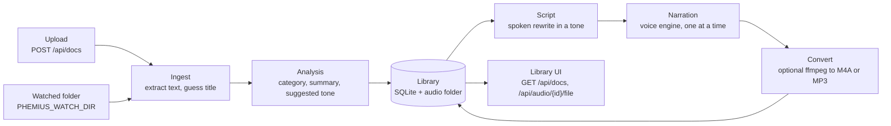

# Architecture

This document explains how Phemius turns a document into audio, which package
does what, and the decisions behind the design. It is for contributors and for
anyone deciding whether Phemius fits their setup.

It describes the code on `main`. Planned parts are marked as planned.

## Pipeline

1. **Ingest.** A file arrives through an upload or the watched folder.
   `services/ingest.py` extracts plain text from Markdown, text, reStructuredText,
   HTML, DOCX or PDF, and guesses a title from the first heading or line.
2. **Analysis.** `services/agent.py` picks a category, a one-sentence summary and
   a suggested tone. It uses the script model when one is configured and falls
   back to keyword rules if there is no model or the call fails.
3. **Library.** `store/documents.py` saves the document. Documents are
   deduplicated by a SHA-256 hash of their text, so the same content is stored
   once.
4. **Script.** For each audio (one per tone and voice), a background thread asks
   `services/agent.py` for a spoken script. With a model, a failure raises
   `ModelError` and the audio fails with a hint. Without a model, offline rules
   strip the markdown.
5. **Narration.** The voice engine (`voices/`) writes a WAV file. A lock keeps
   synthesis to one audio at a time, because local voice models are heavy.
   Script writing for several audios can run in parallel.
6. **Convert.** If `PHEMIUS_FORMAT` asks for M4A, MP4 or MP3 and `ffmpeg` is on
   the `PATH`, the WAV is converted. Otherwise the WAV is kept.

Each audio row records its progress: `pending`, `scripting`, `synthesizing`, then
`done` with a file path, or `error` with the message and hint. The web page polls
`GET /api/docs` to show it.

## Components

| Package | Responsibility |
| --- | --- |
| `src/phemius/app.py` | FastAPI app: startup (logging, database, audio folder, folder watcher), request logging, routers and the static UI |
| `src/phemius/config.py` | Reads `PHEMIUS_*` variables and `OPENROUTER_API_KEY` into a `Config` |
| `src/phemius/errors.py` | `PhemiusError` and its subclasses (`NotFoundError`, `InvalidInputError`, `ServiceUnavailableError`, `ModelError`, `VoiceError`), each with a message, optional hint and status code |
| `src/phemius/api/` | Thin routers: `health`, `library_config` (`/api/config`), `docs`, `audio`, plus `errors.py`, which maps every error to `{detail, code, hint, errors}` |
| `src/phemius/services/` | Business logic: `ingest` (text extraction), `agent` (analysis and scripts), `pipeline` (import and audio generation in threads), `uploads`, `health` |
| `src/phemius/models/` | Script model adapters. Today: `openrouter.py`, which maps provider failures to `ModelError` with hints |
| `src/phemius/voices/` | Voice engine adapters behind the `VoiceEngine` protocol: `kokoro.py` (local, optional extra) and `stub.py` (silent audio), plus shared text chunking |
| `src/phemius/sources/` | Source connectors. Today: `folder.py`, a watchdog-based folder watcher |
| `src/phemius/store/` | The only package that runs SQL: connections in WAL mode with a busy timeout, migrations tracked with `PRAGMA user_version`, documents and audio |
| `src/phemius/static/` | The web page served at `/` |

The library is one folder (`PHEMIUS_DATA_DIR`, default `~/.phemius`) holding
`library.db` and `audio/`. Back it up by copying the folder while Phemius is
stopped.

## Decision log

Each decision is recorded as an ADR. Add a new one, with the next number, when a
change reverses or extends a decision. Do not rewrite an accepted ADR; mark it
superseded and link to the new one.

### ADR-001: SQLite in WAL mode and background threads over Postgres and a broker

- **Status:** Accepted
- **Date:** 2026-10-28

**Context.** Phemius is self-hosted by people who want to hear their docs, not
run infrastructure. A new user should go from one install command to hearing
audio in about ten minutes. The workload is a single user with a small library:
few writes (a document import, a status update per audio step) and mostly reads.
Long work (scripts and narration) has to happen in the background.

**Decision.** Store the library in SQLite in WAL mode with a busy timeout, and run
background work in threads, with a SQLite-backed job queue when one is needed. Do
not use Postgres, Redis, Celery or any other broker. All SQL lives in
`src/phemius/store/`.

**Consequences.**

- Installs need no setup: no database server, no broker, no second service.
- The whole library is one database file plus an audio folder, so backing it up
  or moving it is a copy.
- WAL mode lets the UI read while a background thread writes. Write transactions
  stay short, and no network call runs inside one.
- Phemius runs as a single server process. It cannot be scaled out to several
  instances sharing one library.
- Keeping all SQL in `store/` means a future database swap touches one package.

**When to revisit.** Only if Phemius needs multiple server instances, a hosted
multi-user version, or heavy concurrent writes. Revisiting requires a new ADR.

### ADR-002: Pluggable script model and voice adapters

- **Status:** Accepted
- **Date:** 2026-10-28

**Context.** Users bring their own models: a hosted provider with an API key, any
OpenAI-compatible server, or a local LLM such as Ollama. Voices vary the same way
(Kokoro, Piper, OpenAI-compatible speech, ElevenLabs). A fully local setup must
keep working offline. Hard-wiring one provider would lock users in and spread
provider details through the code.

**Decision.** Script models and voice engines live behind small protocols:
`ScriptModel` in `src/phemius/models/` and `VoiceEngine` in
`src/phemius/voices/`. Each provider is one adapter file plus one registry line,
selected by configuration. Adapters map provider failures to `ModelError` or
`VoiceError` with a `message` and a `hint`. No provider-specific code exists
outside these two packages.

**Consequences.**

- Adding a provider is one file and one registry line, and does not touch
  routes, services or the store.
- The stub voice engine and a fake script model let the whole pipeline run in
  tests with no network, keys or model downloads.
- Errors look the same in the UI whichever provider failed, and always carry a
  hint the user can act on.
- Adapters can expose only what every provider supports through the shared
  protocol. Provider-specific features need a protocol change or stay inside the
  adapter.

**Current state.** `VoiceEngine` exists in `src/phemius/voices/__init__.py` with
the Kokoro and stub engines. The script model is OpenRouter only, called directly
from `services/agent.py`. The `ScriptModel` protocol and registry are planned
(#4).

**When to revisit.** If a provider needs a fundamentally different interaction
than the protocols allow (for example streaming audio or multi-step tool use),
extend the protocol through a new ADR rather than special-casing the provider.
